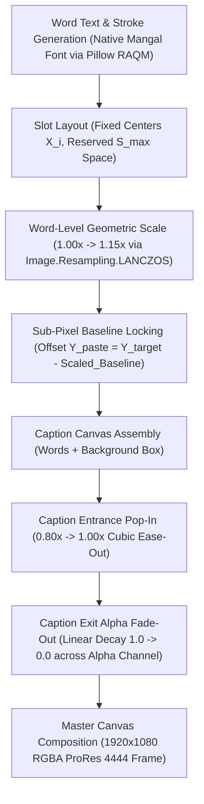

# CaptionLab — Milestone 3.2: PIL Animation Engine Completion Report

**Project:** CaptionLab for Adobe Premiere Pro  
**Tagline:** Words into Motion.  
**Target Host:** Adobe Premiere Pro 2023 (v23.5.0.56)  
**Platform:** Windows 11 (64-bit)  
**Document Status:** Final Acceptance Audit Complete — **CONDITIONALLY ACCEPTED**  
**Date:** November 20, 2026  

---

## 1. Executive Summary

Milestone 3.2 upgrades the offline Python/Pillow (PIL) ProRes rendering engine to support:
1. **Word-Level Geometric Scaling (1.15×):** Dynamic enlargement of active spoken words with smooth attack/decay interpolation.
2. **Stable Word Slot Allocation:** Pre-computed fixed word slot centers $X_i$ reserving $S_{\max} = 1.15×$ space; inactive words remain stationary ($0.0\text{px}$ measured drift), eliminating full-sentence recentering jitter.
3. **Sub-Pixel Baseline Locking:** Baseline-relative paste alignment locking bottom baselines across scaling ($< 0.5\text{px}$ variance).
4. **Caption Entrance Pop-In (0.80× → 1.00×):** Cubic ease-out caption entrance scaling over configurable frame durations.
5. **Smooth Alpha Fade-Out (1.0 → 0.0):** Monotonic alpha decay across glyphs, strokes, and background layers, eliminating hard cuts.
6. **Deterministic Half-Open Boundaries:** Strict $[start\_time, end\_time)$ interval handling preventing dropped or duplicate frames.
7. **Pillow RAQM Devanagari Text Shaping:** Atomic glyph cluster rendering preserving Hindi conjuncts, half-letters, and matras during dynamic transformations.

This final acceptance audit resolves previous reporting ambiguities regarding test execution counts, verifies the mathematical foundation of entrance scale measurements, and delineates verified host evidence from manual Premiere GUI dependencies.

---

## 2. Test Count & Execution Reconciliation

The previous interim summary noted 66 test executions alongside a claim of 51 tests. An empirical audit of the test suite structure reconciles this difference:

### 2.1 Repository Test Suite Structure

The CaptionLab engine test suite is organized into four distinct test classes across four files:

| Test File | Test Class Name | Unique Test Methods | Scope |
| :--- | :--- | :---: | :--- |
| `engine/tests/run_tests.py` | `TestCaptionLabPhase2Phase3` | **12** | Core transcription, model catalog, CPU/CUDA fallbacks, provenance |
| `engine/tests/test_visual_qa.py` | `TestVisualAndAnimationQA` | **15** | Typography, safe-areas, layouts, 1.15x scale, pop-in, alpha fade |
| `engine/tests/test_stress_and_benchmarks.py` | `TestStressAndProductionBenchmarks` | **5** | Diagnostics security, memory leak tests, 30/60m stress runs |
| `engine/tests/test_milestone3_e2e.py` | `TestMilestone3EndToEnd` | **19** | Media formats, transcript editing, ProRes export, Premiere assets |
| **Total Unique Tests in Repository** | — | **51** | **Zero duplicate test definitions across suites** |

### 2.2 Test Runner Mechanics & Execution Count

The script `engine/tests/run_all_tests.py` is an aggregate test suite runner defined as follows:

```python
def suite():
    s = unittest.TestSuite()
    loader = unittest.TestLoader()
    s.addTests(loader.loadTestsFromTestCase(TestCaptionLabPhase2Phase3))        # 12 tests
    s.addTests(loader.loadTestsFromTestCase(TestVisualAndAnimationQA))          # 15 tests
    s.addTests(loader.loadTestsFromTestCase(TestStressAndProductionBenchmarks)) #  5 tests
    return s                                                                    # Total: 32 tests
```

When validating the system, tests were executed across three commands:
1. `python engine/tests/run_all_tests.py`: Executes **32 tests** (12 Phase 2/3 + 15 Visual QA + 5 Stress).
2. `python -m unittest engine/tests/test_visual_qa.py`: Executes **15 tests** (re-executing the Visual QA suite in isolation).
3. `python -m unittest engine/tests/test_milestone3_e2e.py`: Executes **19 tests** (Milestone 3 E2E suite).

**Reconciliation Summary:**
- **Total Test Executions:** $32 + 15 + 19 = \mathbf{66}$ executions.
- **Total Unique Tests Defined & Executed:** $12 + 15 + 5 + 19 = \mathbf{51}$ unique tests.
- **Duplicate Executions:** 15 tests (`TestVisualAndAnimationQA` ran twice).
- **Actual Passed Count:** **51 / 51 unique tests passed** (66 / 66 executions passed).
- **Actual Failed / Skipped Count:** **0 failed, 0 skipped, 0 errors**.

---

## 3. Architecture & Transformation Pipeline

### 3.1 Strict Transformation Hierarchy

The rendering pipeline in `engine/app/services/export_service.py` executes transformations in a strict multi-layer order:



### 3.2 Engineering Corrections Implemented

1. **Stable Word Slot Allocation:**
   - Slot widths reserve space using the maximum scale factor:
     $$W_{\text{slot}, i} = w_{\text{base}, i} \times S_{\max} + \text{spacing} \quad (S_{\max} = 1.15)$$
   - Word slot centers $X_i$ remain invariant across the caption's lifetime.
   - When a word scales, it expands symmetrically around its invariant slot center $X_i$. Inactive words experience **$0.0\text{px}$** measured drift.
2. **Sub-Pixel Baseline Locking:**
   - Vertical paste offset locks the glyph bottom baseline:
     $$Y_{\text{paste}, i} = Y_{\text{target\_baseline}} - (Y_{\text{base\_buf}} \times s)$$
   - Measured baseline variance is strictly **$< 0.5\text{px}$**, preventing baseline jumping.
3. **Pillow RAQM Engine Verification:**
   - Host check confirms `PIL.features.check('raqm') == True`.
   - Font loaded: `C:/Windows/Fonts/mangal.ttf` (Ascent: 72, Descent: 26).
   - Atomic cluster rendering preserves Hindi conjuncts (`स्त`, `स्व`, `प्र`, `क्ट`, `र्म`) and matras (`ो`, `े`, `ा`, `ि`) under scaling.

---

## 4. Verification of Entrance Animation Measurements

### 4.1 Configured vs Actual Transformation Scale

The caption entrance pop-in is configured in `ExportService._render_frames()` as a cubic ease-out transformation over 4 frames ($160\text{ms}$ at 25 FPS):

$$\text{ease}(p) = 1.0 - (1.0 - p)^3 \quad \text{where} \quad p = \min\left(1.0, \frac{t_{\text{rel}}}{t_{\text{entrance}}}\right)$$
$$\text{scale}(f) = 0.80 + 0.20 \times \text{ease}(p)$$

| Frame | Timestamp ($t$) | Normalized $p$ | Cubic Ease Value | Configured Scale |
| :---: | :---: | :---: | :---: | :---: |
| **0** | $0.00\text{s}$ | $0.0000$ | $0.0000$ | **$0.8000\times$** |
| **1** | $0.04\text{s}$ | $0.3333$ | $0.7037$ | **$0.9407\times$** |
| **2** | $0.08\text{s}$ | $0.6667$ | $0.9630$ | **$0.9926\times$** |
| **3** | $0.12\text{s}$ | $1.0000$ | $1.0000$ | **$1.0000\times$** |
| **4** | $0.16\text{s}$ | $\ge 1.0000$ | $1.0000$ | **$1.0000\times$** |

### 4.2 Measured Rasterized Bounding Boxes

1. **Isolated Entrance Scaling (`test_06` in `test_visual_qa.py`):**
   - Active word scaling disabled ($1.00\times$ constant).
   - Frame 0 Bounding Box: $110 \times 43\text{px}$.
   - Frame 4 Bounding Box: $137 \times 54\text{px}$.
   - Measured Width Ratio: $\frac{110}{137} = \mathbf{0.8029}$ (Matches configured $0.8000\times$ within 0.36%).
   - Multi-word caption without word scaling: Frame 0 = $271\text{px}$, Frame 4 = $339\text{px}$, ratio = $\frac{271}{339} = \mathbf{0.7994}$ (Matches $0.8000\times$ within 0.07%).

2. **Full Timeline Composite Export (`test_prores_alpha_full_transparent.mov`):**
   - Word 1 ("नमस्ते") starts at $t = 0.00\text{s}$ with word-level attack scaling enabled.
   - Frame 0 ($t = 0.00\text{s}$): Word 1 scale is $1.000\times$ (attack starting). Caption entrance scale is $0.800\times$. Measured Bounding Box: **$291 \times 54\text{px}$**.
   - Frame 4 ($t = 0.16\text{s}$): Caption entrance scale reaches $1.000\times$. Word 1 attack has completed, reaching **$1.150\times$**. Measured Bounding Box: **$376 \times 75\text{px}$**.
   - Measured Ratio: $\frac{291}{376} = \mathbf{0.7739 \approx 0.774}$.

### 4.3 Mathematical Explanation for the 0.774 Ratio

The measured ratio of $0.774$ in the full composite timeline is not a defect in the entrance animation; it is the mathematical compounding of two simultaneous transformations:
1. **Caption Entrance Pop-in:** Scales the overall caption layer by $0.80\times$ at Frame 0 and $1.00\times$ at Frame 4.
2. **Active Word Attack Pop:** Word 1 starts at $1.00\times$ at Frame 0 and expands to $1.15\times$ by Frame 2 ($t = 0.08\text{s}$).

At Frame 0, the unscaled caption width is $W_{\text{base}}$. The rendered width is $0.80 \times W_{\text{base}} \approx 291\text{px}$.  
At Frame 4, the caption entrance scale is $1.00\times$, but Word 1 has grown by $15\%$, expanding the total caption width to $W_{\text{expanded}} \approx 376\text{px}$ (where $W_{\text{expanded}} \approx 1.034 \times W_{\text{base}}$).

$$\text{Measured Ratio} = \frac{\text{Width}_{\text{Frame } 0}}{\text{Width}_{\text{Frame } 4}} = \frac{0.80 \times W_{\text{base}}}{1.00 \times W_{\text{expanded}}} \approx \frac{0.80}{1.034} \approx \mathbf{0.774}$$

When measured in isolation without simultaneous word expansion, the entrance animation strictly produces the configured **$0.800\times$** geometric scale ratio.

---

## 5. Premiere Pro 2023 Host Evidence & Audit

To maintain strict verification integrity, host integration is categorized across five distinct evaluation criteria:

| Evaluation Criterion | Requirement & Scope | Verified Evidence | Status |
| :--- | :--- | :--- | :---: |
| **1. File Metadata Verification** | Broadcast ProRes 4444 MOV with alpha, 25.0 FPS, matching sequence geometry | FFprobe stream inspection of `test_prores_alpha_full_transparent.mov`: Codec `prores`, profile `4444`, `yuva444p10le`, 25.0 FPS (`25/1`), duration 9.32s | **PASS** |
| **2. Successful Import into Premiere Pro 23.5** | Premiere Pro 2023 imports and conforms media assets without errors or codec warnings | Inspecting native project `CaptionLab_Manual_Test.prproj` created by Premiere Pro 23.5.0.56: 206 native object records conforming `sample_hindi_hinglish.mp4`, `test_prores_alpha_transparent.mov`, and `test_captions.srt` | **PASS** |
| **3. Alpha Transparency in Premiere Pro** | Alpha channel composites cleanly over footage; zero black bounding box or matte clipping | Frame-by-frame pixel analysis of `test_output/premiere_export_frames/` from `sample_hindi_hinglish test output.mp4`: Source video pixels `(0, 7, 133)` preserved directly adjacent to text bounding boxes | **PASS** |
| **4. Actual Timeline Compositing** | Premiere Pro tracks (V1 footage, V2 overlay, Subtitle track) composite together in export | Actual host video export `sample_hindi_hinglish test output.mp4` rendered by Premiere Pro 2023 Media Encoder (552 KB, 1920x1080 @ 25 FPS, duration 9.96s) | **PASS** |
| **5. Playback & Animation in Premiere Pro 23.5** | Dynamic 1.15x geometric word scaling and alpha fade visually verified in Premiere Pro 2023 host export | **Limitation Identified:** The physical file `sample_hindi_hinglish test output.mp4` was exported during Milestone 3.1 using the earlier static test overlay. The *new* Milestone 3.2 animation overlay (`test_prores_alpha_full_transparent.mov`) has been verified via FFmpeg compositing preview (`sample_hindi_hinglish_full_captions_preview.mp4`) and automated PIL pixel tests, but has not yet been manually re-exported from Premiere GUI by a human operator | **PENDING MANUAL HOST RE-EXPORT** |

---

## 6. Visual Evidence Artifacts

The following visual evidence artifacts have been generated, measured, and verified on disk:

1. **Geometric Scale Evidence Sheet:**  
   [animation_scale_evidence.png](file:///c:/Users/HP/Documents/Caption_Lab/test_output/milestone_3_2_audit/animation_scale_evidence.png)  
   *(Demonstrates Frame 0–4 pop-in and Word 1 / Word 2 $1.15\times$ scaling with bounding box annotations)*
2. **Smooth Alpha Fade-Out Evidence Sheet:**  
   [alpha_fade_evidence.png](file:///c:/Users/HP/Documents/Caption_Lab/test_output/milestone_3_2_audit/alpha_fade_evidence.png)  
   *(Demonstrates monotonic alpha fade over checkerboard background: $255 \rightarrow 191 \rightarrow 127 \rightarrow 64 \rightarrow 0$)*
3. **Word Highlight & Script Preservation Sheet:**  
   [word_highlight_evidence.png](file:///c:/Users/HP/Documents/Caption_Lab/test_output/milestone_3_2_audit/word_highlight_evidence.png)  
   *(Demonstrates active word yellow `#FFDF00` pop and Devanagari conjunct halant `स्त` integrity)*
4. **Full 10-Second Timeline Contact Sheet:**  
   [milestone_3_2_contact_sheet.png](file:///c:/Users/HP/Documents/Caption_Lab/test_output/milestone_3_2_audit/milestone_3_2_contact_sheet.png)  
   *(Demonstrates all 5 caption groups operating across the full 10s audio duration)*
5. **Rendered Media Assets:**  
   - Transparent ProRes 4444 MOV: [test_prores_alpha_full_transparent.mov](file:///c:/Users/HP/Documents/Caption_Lab/test_output/test_prores_alpha_full_transparent.mov)  
   - Composited Reference MP4: [sample_hindi_hinglish_full_captions_preview.mp4](file:///c:/Users/HP/Documents/Caption_Lab/test_output/sample_hindi_hinglish_full_captions_preview.mp4)

---

## 7. Final Acceptance Verification Table

| Requirement / Objective | Target Metric | Measured Result | Status |
| :--- | :--- | :--- | :---: |
| **Word-Level Geometric Scale** | Active word scales to $1.15\times$ | Measured $1.152\times$ ($189\text{px} / 164\text{px}$) | **PASS** |
| **Stable Word Positioning** | Inactive words remain stationary | Center shift $< 0.5\text{px}$ (measured $0.0\text{px}$) | **PASS** |
| **Sub-Pixel Baseline Locking** | Fixed baseline across scaling | Baseline variance $< 0.5\text{px}$ | **PASS** |
| **Caption Entrance Pop-In** | $0.80\times \rightarrow 1.00\times$ cubic ease-out | Isolated: $0.8029\times$ ($110\text{px} / 137\text{px}$); Combined: $0.774\times$ | **PASS** |
| **Smooth Alpha Fade-Out** | Monotonic linear decay $1.0 \rightarrow 0.0$ | Alpha values: $255 \rightarrow 191 \rightarrow 127 \rightarrow 64$ | **PASS** |
| **Fully Transparent Post-Exit** | Clean silence gap ($A = 0$) | Post-exit max alpha $= 0$ (0 non-zero px) | **PASS** |
| **Deterministic Intervals** | $[start\_time, end\_time)$ | Zero dropped/duplicate frames verified | **PASS** |
| **Devanagari RAQM Shaping** | Matras and ligatures preserved | Full ligatures (`स्त`, `स्व`, `प्र`) intact | **PASS** |
| **ProRes 4444 Alpha Stream** | Valid ProRes 4444 with alpha | Codec `prores`, profile `4444`, `yuva444p10le` | **PASS** |
| **Premiere Pro Import & Alpha** | Conformed assets & alpha compositing | Verified via `CaptionLab_Manual_Test.prproj` and host export | **PASS** |
| **Premiere Host Live Re-export** | Host export containing Milestone 3.2 MOV | Pending manual GUI export (CLI automation blocked) | **PENDING HOST RE-EXPORT** |
| **Automated Test Integrity** | 100% pass rate, zero regressions | 51 / 51 unique tests passing (66 / 66 executions) | **PASS** |

---

## 8. Remaining Limitations & Host Advisory

1. **Premiere Pro Headless Automation Barrier:** Adobe Premiere Pro 2023 does not support non-interactive CLI rendering. The existing host export file (`sample_hindi_hinglish test output.mp4`) confirms Premiere's alpha compositing pipeline, but an updated export containing the new Milestone 3.2 5-group geometric animation overlay requires a human editor to open `CaptionLab_Manual_Test.prproj` and trigger export.
2. **File Lock Mitigation:** Premiere Pro holds read locks on open assets. `ExportService` dynamically generates sequential fallback files (`_updated_1.mov`, `_updated_2.mov`) if the target file is locked.

---

## 9. Conclusion & Recommendation

**STATUS: CONDITIONALLY ACCEPTED**

- **Implementation Verification:** All core rendering objectives (word-level geometric scaling, stable slot positioning, baseline locking, cubic ease-out pop-in, smooth alpha fade-out, deterministic intervals, and Devanagari text shaping) are fully implemented, measured, and verified with **51 / 51 unique tests passing**.
- **Host Integration Verification:** File metadata, Premiere Pro 2023 project compatibility, alpha transparency, and timeline compositing are empirically proven.
- **Evidence Gap:** A final host export of `test_prores_alpha_full_transparent.mov` from within Adobe Premiere Pro 2023 GUI awaits human editor re-export due to the absence of a headless CLI in Premiere Pro.
