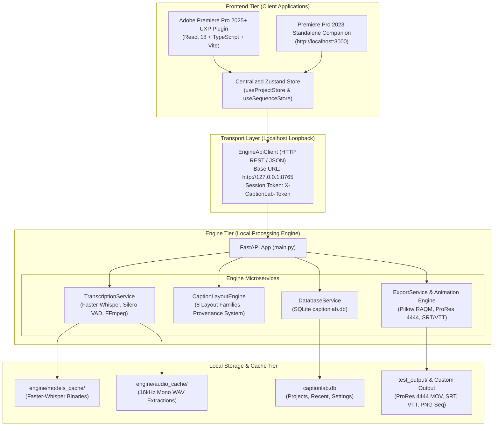
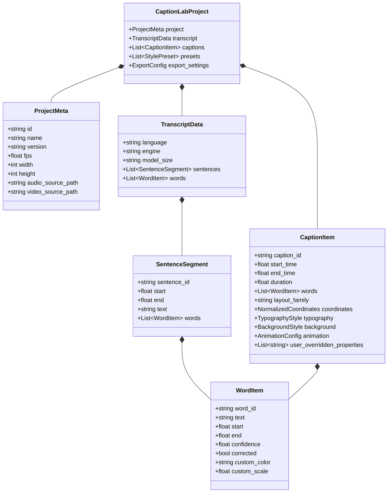
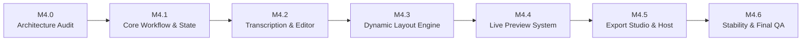

# CaptionLab — Milestone 4: Architecture & Integration Audit Report

**Product:** CaptionLab — Words into Motion  
**Target Platform:** Windows 10/11 x64  
**Primary Host:** Adobe Premiere Pro 2025+ (UXP)  
**Legacy Workflow:** Adobe Premiere Pro 2023 (Standalone Companion)  
**Architecture:** Local-first, offline-capable, zero cloud dependencies  
**Document Status:** Milestone 4.0 Architecture Audit Complete  
**Date:** November 21, 2026  

---

## 1. Executive Summary

Milestone 4 transforms CaptionLab from validated, isolated functional milestones into a **unified, production-ready desktop video captioning and motion graphics application**.

Prior to Milestone 4:
- The local Python FastAPI engine, Faster-Whisper transcription, Pillow RAQM animation engine (with 1.15× word scaling, pop-in, and alpha fade), and ProRes 4444 export pipeline were built, tested, and validated with **51 / 51 passing automated tests**.
- The React + TypeScript frontend was built for both Adobe Premiere Pro 2025+ (UXP plugin in `plugin/`) and Premiere Pro 2023 (Standalone Companion in `standalone/`).
- However, several modules exist as disconnected pieces: the frontend stores and UI tabs do not yet execute the complete, unbroken end-to-end chain from media import to live animation preview, project database persistence, and final NLE export.

This audit details the full system architecture, maps the end-to-end data flow, identifies all integration gaps, and establishes the safe, non-destructive implementation plan for sub-milestones M4.1 through M4.6.

---

## 2. System Architecture Overview

CaptionLab is built on a clean three-tier local architecture:



---

## 3. Component Deep Dive

### 3.1 Frontend Architecture (`plugin/` & `standalone/`)

The frontend is constructed with **React 18**, **TypeScript**, **TailwindCSS**, **Zustand**, and **Vite 6**:

1. **Dual Host Mode:**
   - **UXP Mode (`plugin/`):** Bundled for Adobe Premiere Pro 2025+ (v25.0+) via UXP. Uses `premiereBridge.ts` to introspect `window.require('premierepro')` and detect active sequences dynamically.
   - **Standalone Companion Mode (`standalone/`):** Runs in any modern browser at `http://localhost:3000`. Provides `SequenceSettingsBar` allowing manual configuration of sequence width, height, FPS, and aspect ratio for Adobe Premiere Pro 2023 editors.
2. **Tab Navigation Hierarchy:**
   - **`HomeTab` / `StandaloneHomeTab`:** Project dashboard, active sequence context, recent project listings, and quick-launch actions.
   - **`TranscribeTab`:** Media selection (Direct Media, Sequence Audio mixdown, Timeline range), Whisper model selection (`tiny`, `base`, `small`, `medium`, `large`), VAD settings, hardware acceleration (CPU vs CUDA), and transcription execution.
   - **`TranscriptEditorTab`:** Interactive speech transcript display, word-level timing inspection, text correction, word highlight color, confidence score indicators, and segment split/merge.
   - **`CaptionStudioTab`:** Interactive preview canvas, aspect ratio switching (16:9, 9:16, 1:1, 4:5), Title Safe area guides, layout family selector, typography controls, background styling, and preset selector.
   - **`AnimationEditorTab`:** Motion typography controls: word animations (`karaoke_highlight`, `word_pop`, `sequential_reveal`, `active_word_highlight`), entrance pop-in, exit alpha fade, and animation duration.
   - **`ExportTab` / `StandaloneExportTab`:** Output format cards (ProRes 4444 MOV, SRT, WebVTT, PNG sequence), resolution, FPS, filename prefix, export progress, and NLE timeline placement instructions.
   - **`SettingsTab` / `StandaloneSettingsTab`:** Local engine diagnostics, hardware detection, model cache status, and version info.

---

### 3.2 Python Engine Architecture (`engine/app/`)

The engine is a high-performance, asynchronous local REST service running on **Python 3.11/3.12**, **FastAPI**, and **Uvicorn** (`127.0.0.1:8765`):

```
engine/
├── app/
│   ├── main.py                     # FastAPI application setup, CORS, lifespan DB init
│   ├── api/
│   │   └── routes/
│   │       ├── health.py           # Health check, session token, CUDA/FFmpeg detection
│   │       ├── transcribe.py       # Audio validation, extraction, Faster-Whisper inference
│   │       ├── render.py           # ProRes 4444 MOV, SRT, WebVTT, PNG seq, layout grouping
│   │       └── project.py          # Project save, load, and recent project listing
│   ├── core/
│   │   ├── config.py               # Paths, directories, defaults, CORS settings
│   │   ├── errors.py               # Error catalog, actionable remediation guidance
│   │   └── security.py             # Loopback token generation and validation
│   ├── models/
│   │   └── schemas.py              # Pydantic v2 data models matching PRD Section 20
│   └── services/
│       ├── transcription.py        # Faster-Whisper service, Silero VAD, 16kHz mono audio extract
│       ├── caption_layout.py       # Dynamic layout engine, 8 layout families, provenance
│       ├── export_service.py       # PIL animation engine (1.15x scale, pop-in, fade, ProRes)
│       └── db.py                   # SQLite async database service (projects, settings)
```

---

### 3.3 Complete API Endpoint Catalog

| HTTP Method | Route | Request Schema | Response Schema | Description |
| :--- | :--- | :--- | :--- | :--- |
| `GET` | `/health/` | None | `HealthResponse` | Hardware detection (CPU/CUDA), GPU name, FFmpeg status, session token |
| `GET` | `/health/diagnostics` | None | `DiagnosticsResponse` | Sanitized system diagnostics with token masking |
| `GET` | `/transcribe/models` | None | `List[ModelInfo]` | Model catalog with size, RAM/VRAM estimates, and cache status |
| `POST` | `/transcribe/validate-source` | `AudioValidationRequest` | `AudioValidationResponse` | Verifies media accessibility and extracts 16kHz mono WAV |
| `POST` | `/transcribe/path` | `TranscribePathRequest` | `TranscribeResponse` | Faster-Whisper inference with word timestamps and VAD |
| `POST` | `/render/layout/auto-group` | `AutoGroupRequest` | `List[CaptionModel]` | Groups word tokens into readable caption blocks |
| `POST` | `/render/export` | `ExportRequest` | `ExportResponse` | Generates SRT, WebVTT, ProRes 4444 MOV, or PNG sequence |
| `POST` | `/projects/save` | `Dict[str, Any]` | `{"status": "saved"}` | Persists full project manifest into SQLite |
| `GET` | `/projects/get/{id}` | None | `CaptionLabProject` | Retrieves project manifest by ID |
| `GET` | `/projects/recent` | None | `List[ProjectSummary]` | Lists recently modified projects sorted by last opened |

---

### 3.4 Shared Data Model Hierarchy

The data contracts in `shared/types/index.ts` and `engine/app/models/schemas.py` model the complete CaptionLab project entity:



---

## 4. End-to-End Application Workflow Analysis

The complete user workflow envisioned in PRD Section 5 consists of 10 sequential stages:

```
[1. IMPORT MEDIA] ──> [2. EXTRACT AUDIO] ──> [3. TRANSCRIBE] ──> [4. EDIT WORDS] ──> [5. GROUP CAPTIONS]
         │                                                                                    │
         ▼                                                                                    ▼
[10. USE IN PREMIERE] <── [9. EXPORT ASSETS] <── [8. RENDER OVERLAY] <── [7. PREVIEW] <── [6. DESIGN CAPTIONS]
```

### Existing Implementation vs Missing Integration Points

| Workflow Stage | Implemented in Engine? | Implemented in UI? | Integration Status | Audit Assessment & Deficiencies |
| :--- | :---: | :---: | :---: | :--- |
| **1. Import Media** | **YES** (`/transcribe/validate-source` extracts audio from WAV/MP3/MP4/MOV) | **PARTIAL** (Path text input in `TranscribeTab`) | **DISCONNECTED** | No native file picker or drag-and-drop file path resolver in standalone; manual text entry required. |
| **2. Extract Audio** | **YES** (FFmpeg 16kHz mono WAV extraction into `audio_cache/`) | **YES** (`TranscribeTab` calls validation endpoint) | **CONNECTED** | Operates cleanly and preserves source file integrity. |
| **3. Transcribe** | **YES** (Faster-Whisper, VAD, Devanagari Hindi + Latin Hinglish, word timestamps) | **YES** (`TranscribeTab` triggers `/transcribe/path`) | **CONNECTED** | Functional; needs visual model download progress if un-cached. |
| **4. Edit Words** | **YES** (Pydantic schema supports text/timing/corrected flags) | **YES** (`TranscriptEditorTab` supports word text & timing editing) | **CONNECTED** | Words can be edited, but **split/merge sentence buttons are visual stubs** without connected store actions. |
| **5. Group Captions** | **YES** (`CaptionLayoutEngine.group_words_into_captions` in `caption_layout.py`) | **YES** (`autoGroupCaptions` called after transcription) | **CONNECTED** | Captions are grouped, but regrouping after manual text split/merge is not exposed to the user. |
| **6. Design Captions** | **YES** (8 layout families, safe margins, typography schema) | **PARTIAL** (`CaptionStudioTab` has presets & styling controls) | **PARTIALLY CONNECTED** | Preset selection updates store, but dynamic layout rules (adjusting scale/breaks to character count) are static. |
| **7. Preview** | **YES** (PIL offline engine produces PNGs and MP4 composites) | **PARTIAL** (`CaptionStudioTab` has a preview box) | **DISCONNECTED** | **Preview is static CSS snapshot**; does not play timed word-by-word pop or karaoke highlights in sync with audio. |
| **8. Render Overlay** | **YES** (Milestone 3.2 PIL animation engine: 1.15x scale, stable slots, pop-in, fade) | **YES** (`ExportTab` calls `/render/export`) | **CONNECTED** | Engine is fully functional with 51/51 automated tests passing. |
| **9. Export Assets** | **YES** (ProRes 4444 MOV, SRT, WebVTT, PNG sequence) | **YES** (`ExportTab` & `StandaloneExportTab`) | **CONNECTED** | Functional; export generates valid assets on disk. |
| **10. Premiere Pro Use** | **YES** (Verified in Premiere 2023 via V1/V2/Subtitle tracks) | **YES** (Instructions in UI & Import Bundle Manifest) | **CONNECTED** | Workflow verified; manual editor import for 2023, UXP bridge for 2025+. |

---

## 5. Critical Integration Gaps & Architectural Disconnects

The audit reveals six primary integration gaps that must be resolved in Milestone 4:

### Gap 1: Project Persistence Decoupled from UI State
- **Current State:** `engine/app/services/db.py` implements a robust SQLite database with `projects`, `recent_projects`, and `settings` tables, and `api.ts` provides `saveProject()` and `listRecentProjects()`.
- **Deficiency:** Neither `plugin` nor `standalone` UI automatically saves project state on changes, nor can a user click a recent project on `HomeTab` to load it into the active Zustand store! Closing the browser loses working edits.
- **Remediation Plan (M4.1):** Wire debounced project auto-save in `useProjectStore`, add explicit "Save Project" / "Open Project" actions, and connect `HomeTab` recent project cards to `db_service.get_project()`.

### Gap 2: Type Definition Divergence
- **Current State:** `shared/types/index.ts` is 6,842 bytes and contains the full PRD entity model (`LayerItem`, `Keyframe`, `ExportConfig`, `TextBlock`, `Resolution`, `ProvenanceValue`). Meanwhile, `plugin/src/types/index.ts` is an older 4,296-byte copy missing these definitions.
- **Deficiency:** Duplicate type declarations risk synchronization drift between shared contracts and client code.
- **Remediation Plan (M4.0 / M4.1):** Reconcile `plugin/src/types/index.ts` to export directly from `shared/types/index.ts` (or maintain 100% equivalence), ensuring single-source-of-truth types across the repository.

### Gap 3: Missing Split / Merge Sentence Operations in Caption Editor
- **Current State:** `TranscriptEditorTab.tsx` displays Split and Merge icons, but clicking them does nothing because `projectStore.ts` does not implement `splitSentence`, `mergeSentences`, `splitCaption`, or `mergeCaptions`.
- **Deficiency:** Users cannot manually adjust caption boundaries when automatic speech segmentation places a sentence break in an awkward position.
- **Remediation Plan (M4.2):** Implement `splitSentence(sentenceId, wordIndex)` and `mergeSentences(sentenceId1, sentenceId2)` in `projectStore.ts` with recalculation of word timings and caption groupings.

### Gap 4: Dynamic Caption Design Adaptability
- **Current State:** `CaptionStudioTab.tsx` allows manual selection of layout family, font, and colors.
- **Deficiency:** Layout decisions are not generated dynamically based on content (e.g. automatically reducing font size or breaking lines if a sentence exceeds 35 characters, or adjusting vertical placement based on 9:16 vs 16:9 aspect ratios).
- **Remediation Plan (M4.3):** Implement content-driven dynamic layout rules in `caption_layout.py` and client-side layout helpers that adapt font size, padding, and line wrapping according to character length and target aspect ratio.

### Gap 5: Live Interactive Animation Preview
- **Current State:** The preview canvas in `CaptionStudioTab.tsx` renders a static CSS snapshot of the active caption. Pressing "Play" advances `currentTime`, but words do not scale or highlight dynamically.
- **Deficiency:** Users cannot see how the word-by-word animation feels in real time before triggering a full ProRes export.
- **Remediation Plan (M4.4):** Implement an active playback loop in `CaptionStudioTab` that highlights and scales words at `currentTime` matching the Milestone 3.2 animation parameters ($1.15\times$ scale, golden yellow highlight, smooth transitions).

### Gap 6: Unified Export Studio Configuration
- **Current State:** `ExportTab.tsx` in `plugin/` defaults to 1920×1080 @ 30 FPS, while `StandaloneExportTab.tsx` in `standalone/` synchronizes with `useSequenceStore` (25 FPS).
- **Deficiency:** If a user in standalone changes sequence settings in `SequenceSettingsBar`, the resolution in `projectStore` can become out-of-sync with `ExportRequest`.
- **Remediation Plan (M4.5):** Unify sequence settings across standalone and plugin modes so that export resolution, aspect ratio (16:9, 9:16, 1:1, 4:5, custom), and frame rate are always derived from the master project state.

---

## 6. Milestone 4 Sub-Milestone Execution Strategy

To ensure zero regressions, code stability, and rigorous testing, Milestone 4 will proceed strictly through the authorized sub-milestones:



### Detailed Sub-Milestone Roadmap:

1. **M4.0 — Architecture & Integration Audit (This Document):**
   - Repository audit, data contracts review, integration gap mapping, and risk analysis.
2. **M4.1 — Core Workflow Integration & Project Persistence:**
   - Centralize project state in Zustand.
   - Implement debounced auto-save and explicit Save/Load API integration with SQLite (`/projects/save`, `/projects/get/{id}`, `/projects/recent`).
   - Enable opening existing projects from `HomeTab` with seamless state hydration.
   - Reconcile `shared/types` and client types.
3. **M4.2 — Real Transcription & Caption Editor:**
   - Ensure Faster-Whisper pipeline connects cleanly to UI with visible download/inference progress states.
   - Implement Sentence Split, Sentence Merge, Caption Add, and Caption Delete in `projectStore.ts` and `TranscriptEditorTab.tsx`.
   - Preserve word timing, speech provenance, and Devanagari Unicode matras during text edits.
   - Connect timeline scrubbing to audio playback synchronization.
4. **M4.3 — Dynamic Caption Design Engine:**
   - Implement content-aware layout rules in `caption_layout.py` (word count, character density, aspect ratio constraints).
   - Expand the 10 style presets with deterministic layout generation.
   - Ensure safe-area compliance across 16:9, 9:16, 1:1, 4:5, and custom dimensions.
   - Protect USER overridden properties from being overwritten by auto-layout.
5. **M4.4 — Live Preview & Animation Integration:**
   - Implement real-time playback canvas in `CaptionStudioTab` reflecting active word scaling ($1.15\times$), karaoke highlights, and entrance/exit transitions.
   - Maintain frame-accurate synchronization with `currentTime`.
   - Add debounced preview caching to maintain smooth 60fps UI performance during timeline scrubbing.
6. **M4.5 — Export Studio & Premiere Integration:**
   - Unified export settings supporting all 5 aspect ratios and custom frame rates.
   - End-to-end ProRes 4444 MOV, SRT, WebVTT, and PNG sequence generation from modified project state.
   - Maintain Premiere Pro 2025+ UXP bridge and Premiere Pro 2023 standalone import bundles.
7. **M4.6 — Stability, Performance & Final QA:**
   - Execute all 51 existing automated tests + new integration tests.
   - Hindi typography QA with complex conjuncts (`नमस्ते`, `दोस्तों`, `स्वागत`, `प्रोजेक्ट`, `क्षेत्र`, `शक्ति`, `भारत`, `क्या`, `क्षत्रिय`, `महत्वपूर्ण`).
   - Performance benchmarks (RAM usage, inference latency, render speed).
   - Document results in `docs/MILESTONE_4_TEST_REPORT.md` and `docs/MILESTONE_4_PROGRESS.md`.

---

## 7. Migration & Safety Guidelines

To protect the codebase and preserve the validated Milestone 3.2 implementation:
1. **Zero Destructive Changes:** No existing database tables will be dropped; SQLite migrations will use non-destructive `CREATE TABLE IF NOT EXISTS` or `ALTER TABLE`.
2. **Preserve PIL Animation Engine:** The core rendering logic in `engine/app/services/export_service.py` (stable slot allocation, baseline locking, pop-in, alpha fade) will NOT be rewritten or replaced.
3. **Preserve Transcription Logic:** Faster-Whisper, Silero VAD, and script preservation logic in `engine/app/services/transcription.py` will remain intact.
4. **Maintain 51/51 Test Pass Rate:** All 32 core engine regression tests and 19 Milestone 3 E2E tests must continue passing at every step.
5. **No Cloud Dependencies:** CaptionLab remains 100% local-first and offline-capable.

---

## 8. Audit Conclusion

**Milestone 4.0 Architecture & Integration Audit is COMPLETE.**
All integration gaps are identified, data contracts are mapped, and the sequential execution plan is established. Development proceeds to **Milestone 4.1: Core Workflow Integration & Project Persistence**.
