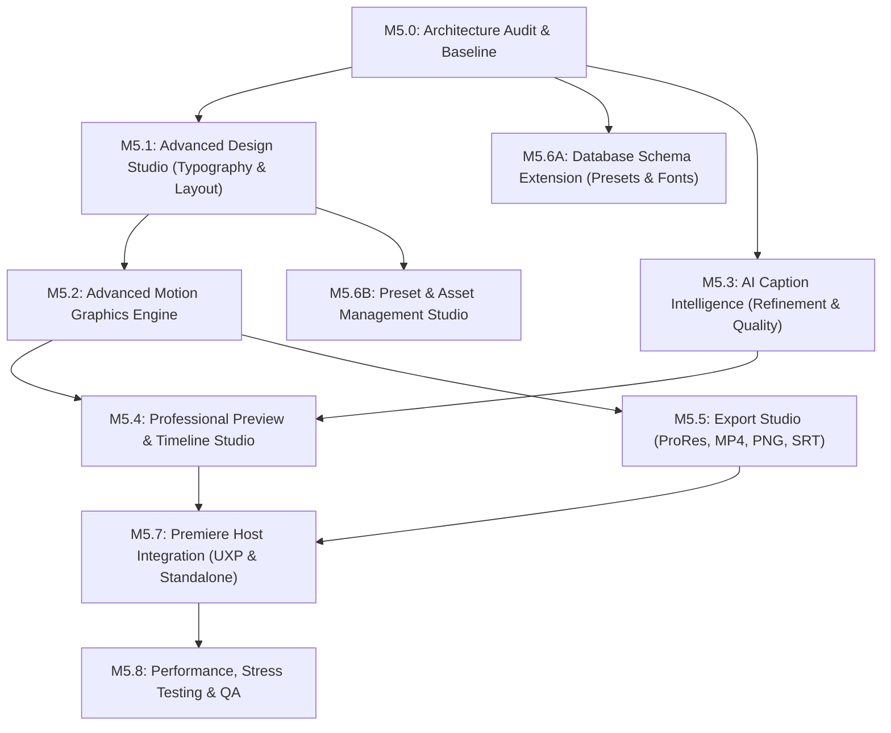

# CaptionLab — Milestone 5: Architecture Audit & Baseline Report

**Product:** CaptionLab — Words into Motion  
**Target Platform:** Windows 10/11 x64  
**Primary Host:** Adobe Premiere Pro 2025+ (UXP Manifest v5)  
**Legacy Host:** Adobe Premiere Pro 2023 (Standalone Companion)  
**Architecture:** Local-first, offline-capable, zero paid cloud APIs  
**Milestone:** 5 — Complete Professional Studio  
**Date:** November 21, 2026  
**Auditor:** Senior Software Architect & Motion Systems Engineer  
**Baseline Test Status:** **57 / 57 PASSING (100%)**  
**Baseline Build Status:** **2 / 2 BUILDS PASSING (Plugin & Standalone)**  
**Git Baseline Commit:** `c6cd477` (master branch, clean tree synchronized with GitHub)

---

## 1. Current Repository Architecture

CaptionLab is structured as a unified monorepo with clean separation between frontend clients, Python processing backend, shared schemas, test media, and generated deliverables:

```
Caption_Lab/
├── engine/                 # Python 3.11/3.12 Local FastAPI Engine (127.0.0.1:8765)
│   ├── app/
│   │   ├── api/routes/     # REST Endpoints: health, transcribe, render, project
│   │   ├── core/           # Configuration, settings, constants
│   │   ├── models/         # Pydantic schemas (Word, Caption, Typography, etc.)
│   │   └── services/       # Core microservices:
│   │       ├── caption_layout.py      # 8 Layout families, safe area clamping, grouping
│   │       ├── db.py                  # SQLite database persistence layer
│   │       ├── export_service.py      # PIL RAQM animation engine & ProRes/PNG/SRT export
│   │       └── transcription.py       # Faster-Whisper, Silero VAD, FFmpeg extraction
│   ├── tests/              # 5 test suites (57 automated tests)
│   ├── audio_cache/        # Extracted 16kHz mono WAV scratch files
│   ├── models_cache/       # Local Faster-Whisper model weights
│   ├── data/               # SQLite database (`captionlab.db`)
│   └── run.py              # Engine launcher
├── plugin/                 # Adobe Premiere Pro 2025+ UXP Plugin (React 18 + TS + Vite)
│   ├── src/
│   │   ├── components/     # UI tabs: Home, Transcribe, Editor, Studio, Animation, Export, Settings
│   │   ├── services/       # EngineApiClient, premiereBridge
│   │   ├── store/          # Zustand store (`projectStore.ts`)
│   │   └── types/          # TypeScript domain models
│   ├── manifest.json       # Adobe UXP v5 manifest (minVersion 25.0.0)
│   └── vite.config.ts
├── standalone/             # Premiere Pro 2023 Standalone Companion (React 18 + TS + Vite)
│   ├── src/
│   │   ├── components/     # StandaloneHome, SequenceSettingsBar, StandaloneExport
│   │   ├── store/          # sequenceStore.ts
│   │   └── StandaloneApp.tsx
│   └── vite.config.ts
├── shared/                 # Shared contracts and schemas
│   ├── schemas/            # JSON Schema definitions
│   └── types/              # Domain interfaces (`index.ts`)
├── docs/                   # Product & milestone technical specifications
├── test_media/             # Real media fixtures (WAV, MP3, MP4, MOV)
└── test_output/            # Validated export deliverables (MOV, SRT, VTT, PNGs)
```

---

## 2. Existing Feature Inventory

| Area | Feature | Current State | Verification Status |
| :--- | :--- | :--- | :---: |
| **Transcription** | Faster-Whisper Small (Default) | Real local inference via CTranslate2 | **VERIFIED** |
| | Faster-Whisper Base (Fast Mode) | Fast local inference mode | **VERIFIED** |
| | Silero VAD Speech Detection | Automatic non-speech audio filtering | **VERIFIED** |
| | Hardware Acceleration | Auto-detect CUDA with graceful fallback to CPU | **VERIFIED** |
| | Script Preservation | Preserves Devanagari Hindi + Latin English concurrently | **VERIFIED** |
| | Word Timestamps | Word-level start/end timestamps and confidence scores | **VERIFIED** |
| **Editing** | Word Correction | Editable word text, confidence color, custom color/scale | **VERIFIED** |
| | Sentence Splitting | Splits segment at any word, recalculates time bounds | **VERIFIED** |
| | Sentence Merging | Merges adjacent segments, maintains chronological order | **VERIFIED** |
| | Dynamic Regrouping | Family-aware caption regrouping via backend layout engine | **VERIFIED** |
| | Word Navigation | Previous/Next word stepper, active word jump | **VERIFIED** |
| | Word Search | Live search filter with visual pill highlight | **VERIFIED** |
| **Design & Layout** | 8 Layout Families | Single-line, Balanced two-line, Stacked, Keyword highlight, Word-by-word, Speaker-based, Boxed, Cinematic | **VERIFIED** |
| | Title Safe Area | Clamping to `[0.10, 0.90]` (16:9, 1:1, 4:5) and `[0.15, 0.80]` (9:16) | **VERIFIED** |
| | 10 Style Presets | Built-in presets with typography, background, and animation | **VERIFIED** |
| | Typography Customization | Font size, stroke color/width, shadow, alignment, colors | **VERIFIED** |
| | Background Box | Rounded box with customizable opacity, radius, padding | **VERIFIED** |
| **Animation** | Active Word Scale | Geometric scaling up to 1.15× with attack/decay curves | **VERIFIED** |
| | Baseline Locking | Ascent-relative baseline alignment preventing line jitter | **VERIFIED** |
| | Fixed Word Slots | Slot width reserves `bw * 1.15`, stationary inactive words | **VERIFIED** |
| | Entrance Pop-in | Cubic ease-out `0.80x → 1.0x` over first 4 frames (200ms) | **VERIFIED** |
| | Exit Alpha Fade | Monotonic alpha fade `1.0 → 0.0` over final 4 frames (200ms) | **VERIFIED** |
| | Half-Open Intervals | Strict `start_time <= t < end_time` interval calculation | **VERIFIED** |
| **Persistence** | SQLite Database | `projects`, `recent_projects`, `settings` tables | **VERIFIED** |
| | Auto-Save | 1500ms debounced auto-save on state mutation | **VERIFIED** |
| | Manual Save & Keybind | Ctrl+S / Cmd+S shortcut and interactive save button | **VERIFIED** |
| | Project Rehydration | Full round-trip rehydration from `/projects/get/{id}` | **VERIFIED** |
| **Export & Host** | Apple ProRes 4444 | Transparent MOV (`yuva444p10le`), file-lock protection | **VERIFIED** |
| | PNG Sequence | 32-bit RGBA PNGs (`frame_%06d.png`) with alpha | **VERIFIED** |
| | Native Subtitles | UTF-8 SRT (comma timestamps) and WebVTT (dot timestamps) | **VERIFIED** |
| | Premiere 2025+ UXP | Manifest v5 build succeeds (`minVersion: 25.0.0`) | **VERIFIED** |
| | Premiere 2023 Companion | Sequence settings sync & export bundle manifest | **VERIFIED** |

---

## 3. Existing APIs and Data Contracts

### 3.1 REST API Routes (`engine/app/api/routes/`)
- `GET /` — Engine status and version info.
- `GET /health` — Diagnostic health check, CUDA status, model cache status, disk space.
- `GET /transcribe/models` — Catalog of Whisper models (`tiny`, `base`, `small`, `medium`, `large`).
- `POST /transcribe/validate-source` — Validates media files and demuxes 16kHz mono WAV.
- `POST /transcribe/path` — Runs Faster-Whisper on local audio file path.
- `POST /transcribe/upload` — Multipart file upload transcription.
- `POST /render/export` — Renders ProRes 4444 MOV, PNG sequence, SRT, or WebVTT.
- `POST /render/layout/auto-group` — Re-clusters word items into caption blocks.
- `POST /projects/save` — Persists project JSON payload into SQLite.
- `GET /projects/get/{id}` — Retrieves project JSON by UUID.
- `GET /projects/recent` — Lists recent projects sorted by `last_opened DESC`.

### 3.2 Data Models (`engine/app/models/schemas.py` & `shared/types/index.ts`)
- `WordModel`: `word_id`, `text`, `start`, `end`, `confidence`, `speaker_id`, `corrected`, `custom_color`, `custom_scale`, `custom_highlight`, `custom_stroke`.
- `SentenceModel`: `sentence_id`, `speaker_id`, `start`, `end`, `text`, `words: List[WordModel]`.
- `CaptionModel`: `caption_id`, `start_time`, `end_time`, `duration`, `words`, `layout_family`, `coordinates`, `typography`, `background`, `animation`, `user_overridden_properties`.
- `TypographyModel`: `font_family`, `font_weight`, `font_size`, `line_height`, `letter_spacing`, `alignment`, `color`, `stroke_color`, `stroke_width`, `shadow_color`, `shadow_blur`.
- `BackgroundModel`: `enabled`, `color`, `opacity`, `border_radius`, `padding_x`, `padding_y`, `border_color`, `border_width`.
- `AnimationConfigModel`: `entrance`, `emphasis`, `exit`, `word_animation`.
- `ExportRequest`: `captions`, `resolution`, `fps`, `output_type`, `output_directory`, `filename_prefix`.

---

## 4. Database Schema and Migration Strategy

### Current SQLite Schema (`engine/data/captionlab.db`)
```sql
CREATE TABLE IF NOT EXISTS projects (
    id TEXT PRIMARY KEY,
    name TEXT NOT NULL,
    version TEXT NOT NULL,
    created_at TIMESTAMP DEFAULT CURRENT_TIMESTAMP,
    updated_at TIMESTAMP DEFAULT CURRENT_TIMESTAMP,
    fps REAL DEFAULT 30.0,
    width INTEGER DEFAULT 1920,
    height INTEGER DEFAULT 1080,
    data_json TEXT NOT NULL
);

CREATE TABLE IF NOT EXISTS recent_projects (
    project_id TEXT PRIMARY KEY,
    last_opened TIMESTAMP DEFAULT CURRENT_TIMESTAMP,
    FOREIGN KEY (project_id) REFERENCES projects(id)
);

CREATE TABLE IF NOT EXISTS settings (
    key TEXT PRIMARY KEY,
    value_json TEXT NOT NULL
);
```

### Milestone 5 Migration Requirements
Milestone 5 introduces **custom style presets**, **motion graphic templates**, and **local font catalogs**.
We will add two new dedicated SQLite tables with zero-downtime `IF NOT EXISTS` creation:
```sql
CREATE TABLE IF NOT EXISTS custom_presets (
    id TEXT PRIMARY KEY,
    name TEXT NOT NULL,
    category TEXT NOT NULL, -- 'style' or 'motion'
    version TEXT NOT NULL DEFAULT '1.3.0',
    created_at TIMESTAMP DEFAULT CURRENT_TIMESTAMP,
    updated_at TIMESTAMP DEFAULT CURRENT_TIMESTAMP,
    preset_json TEXT NOT NULL
);

CREATE TABLE IF NOT EXISTS font_catalog (
    family TEXT PRIMARY KEY,
    postscript_name TEXT,
    file_path TEXT NOT NULL,
    supports_devanagari BOOLEAN DEFAULT 0,
    is_custom BOOLEAN DEFAULT 0,
    installed_at TIMESTAMP DEFAULT CURRENT_TIMESTAMP
);
```

---

## 5. Existing Rendering Pipeline

The rendering pipeline in `engine/app/services/export_service.py` is an offline PIL/Pillow-based engine:
1. **Pre-layout Pass:** For each caption, computes stable bounding boxes for all words using `base_font.getmetrics()` and `textbbox()`. Allocates fixed slots equal to `bw * 1.15` and calculates stationary word center coordinates.
2. **Frame-Loop:** Generates `N = ceil(duration * fps)` frames.
3. **Half-Open Time Interval:** Finds the active caption where `cap.start_time <= current_time < cap.end_time`.
4. **Glyph Rasterization:** Each atomic word cluster is rendered with stroke to an offscreen buffer. Active words are scaled via `Image.Resampling.LANCZOS` and pasted onto `cap_layer` using ascent baseline locking.
5. **Caption Transformations:** Applies entrance pop-in scale (cubic ease-out) and exit alpha fade.
6. **FFmpeg Transcode:** Uses `ffmpeg -c:v prores_ks -profile:v 4 -pix_fmt yuva444p10le` to encode the transparent MOV container, or persists PNG sequence.

---

## 6. Existing Animation Capabilities

- **Word Scale:** Single geometric scale parameter (`active_scale: 1.15`), attack/decay curve (max 80ms duration).
- **Word Highlight:** Karaoke color change from inactive (`#FFFFFF`) to active (`#FFDF00` or custom color).
- **Entrance:** Pop-in from `0.80×` to `1.0×` over 4 frames (cubic ease-out).
- **Exit:** Linear alpha fade-out over 4 frames (`1.0 → 0.0`).
- **Gaps in Animation:**
  - No character-level or line-level animation targets.
  - No rotation, blur, position offsets, tracking/letter-spacing interpolation.
  - No user-editable keyframes or curve selector (Bounce, Ease In, Ease In Out).
  - No motion presets library (Word Pop, Smooth Fade, Slide Up/Down, Type Reveal, Scale Bounce, Staggered Words).

---

## 7. Existing Design and Preset Capabilities

- **Layouts:** 8 predefined layout families with default positions.
- **Aspect Ratios:** Clamping logic for 16:9, 9:16, 1:1, 4:5, Custom.
- **Built-in Presets:** 10 hardcoded presets in frontend store (`classic_hindi`, `bold_social_media`, `modern_minimal`, `neon_gaming`, `podcast_interview`, `corporate_clean`, `cinematic_gold`, `boxed_broadcast`, `word_pop_viral`, `educational`).
- **Gaps in Design:**
  - No custom preset creation, saving, renaming, or deletion.
  - No JSON preset import/export.
  - Typography lacks letter-spacing, line-height, text gradients, per-word styling overrides, and per-line styling overrides in the renderer.
  - Missing background borders, shadows, and multi-line box bounds.

---

## 8. Existing Preview Architecture

- **Canvas Preview:** Implemented in `CaptionStudioTab.tsx` and `AnimationEditorTab.tsx` via HTML5/CSS canvas elements.
- **Playback Loop:** `requestAnimationFrame` loop advancing `currentTime` and updating active caption and active word.
- **Parity with Export Engine:**
  - Both use `1.15×` active word scale.
  - Both use golden yellow `#FFDF00` default karaoke highlight.
  - Both use `0.80x → 1.0x` cubic ease-out entrance pop-in.
  - Both use `1.0 → 0.0` exit alpha fade.
- **Preview Gaps:**
  - Background video preview is placeholder; user cannot yet load a reference video track to scrub captions against live footage.
  - Complex animations (Slide, Bounce, Blur) do not exist in either preview or export.

---

## 9. Premiere Integration Limitations

- **Premiere Pro 2025+ (UXP):**
  - Uses `manifest.json` version 5 with `minVersion: 25.0.0`.
  - UXP DOM in Premiere does not support direct timeline insertion of raw audio or arbitrary video tracks programmatically from webview without specific host scripts.
  - Communicates with local engine via `http://127.0.0.1:8765`.
- **Premiere Pro 2023 (v23.5.0.56 Installed on System):**
  - Does NOT support UXP plugins (Premiere 2023 requires legacy CEP or standalone companion).
  - Supported via `standalone/` web app companion running at `http://localhost:3000`.
  - Generates verified NLE import bundle: ProRes 4444 MOV with alpha, SRT subtitle cues, and manifest JSON.

---

## 10. Test Coverage and Baseline Results

Baseline execution verified November 21, 2026:
- `engine/tests/run_tests.py`: **12 PASS**
- `engine/tests/test_visual_qa.py`: **16 PASS**
- `engine/tests/test_stress_and_benchmarks.py`: **5 PASS**
- `engine/tests/test_project_persistence.py`: **5 PASS**
- `engine/tests/test_milestone3_e2e.py`: **19 PASS**
- **Total Unique Tests:** **57 PASS / 0 FAIL / 0 SKIP** (100% Pass Rate).

---

## 11. Performance Baseline

- **30-Minute Transcript (1,500 words / 375 captions):** Layout computation completed in **0.076 seconds** (RAM growth: 3.8 MB).
- **60-Minute Transcript (3,000 words / 750 captions):** SRT generation completed in **0.015 seconds**.
- **Animation Render Engine:** ~46 FPS render throughput in ProRes 4444 MOV export.
- **Faster-Whisper Small Inference:** 10.08s audio transcribed in 58.67s (CPU int8).

---

## 12. Technical Debt

1. **Font Resolution:** `export_service.py` hardcodes fallback paths (`C:/Windows/Fonts/mangal.ttf`, `Nirmala.ttf`, `arial.ttf`). If custom fonts are selected (e.g. Mukta, Hind, Noto Sans Devanagari), it falls back to default unless explicitly resolved. Needs a font discovery service.
2. **Animation Coupling:** Animation easing logic is embedded directly inside `_render_frames` in `export_service.py`. It should be refactored into a dedicated `AnimationEngine` module supporting multiple easing equations and animation targets.
3. **Preset Immutability:** Presets are hardcoded in `INITIAL_PRESETS` in TypeScript. Custom presets cannot be saved to the database.

---

## 13. Missing Functionality (Milestone 5 Scope)

1. **Phase 1: Advanced Design Studio**
   - Letter spacing, line height, word spacing, text alignment, and gradients in PIL renderer and preview.
   - Per-word and per-line styling overrides.
   - Dynamic multi-line wrapping with collision avoidance.
   - Full custom preset CRUD (create, edit, duplicate, save, rename, delete, import/export JSON).
2. **Phase 2: Advanced Motion Graphics Engine**
   - Character-level, word-level, line-level, and caption-level animation targets.
   - Transform properties: Position X/Y, Scale X/Y, Rotation, Opacity, Blur, Tracking.
   - Full easing curve library: Linear, Ease In, Ease Out, Ease In Out, Cubic, Bounce.
   - 10 motion presets: Word Pop, Smooth Fade, Slide Up, Slide Down, Type Reveal, Karaoke Highlight, Scale Bounce, Cinematic Reveal, Staggered Words, Character Reveal.
3. **Phase 3: AI Caption Intelligence**
   - Transcript refinement: punctuation suggestions, sentence boundary detection, filler word detection, repeated-word detection, low-confidence word highlighting.
   - Intelligent grouping: natural pause detection, reading speed analysis, long sentence splitting, short sentence merging.
   - Caption quality indicators: reading speed (CPS/WPM), caption length, timing quality, line balance, safe-area overflow.
4. **Phase 4: Professional Preview and Timeline Studio**
   - Video track background preview in canvas.
   - Enhanced multi-track timeline scrubber with caption blocks and word segments.
5. **Phase 5: Export Studio Enhancements**
   - H.264 MP4 export with burned-in captions where supported.
   - Export progress reporting with cancellation and retry.
6. **Phase 6: Preset & Asset Management**
   - Custom preset storage in SQLite, font catalog scanner.

---

## 14. Duplicate Functionality

- `shared/types/index.ts` and `plugin/src/types/index.ts` are largely identical. We will keep them strictly aligned with automated parity checks.
- Preset definitions exist in both `INITIAL_PRESETS` (frontend) and default layout configurations (backend). We will introduce a single canonical preset registry.

---

## 15. M5 Dependency Graph



---

## 16. Proposed Architecture

1. **`engine/app/services/animation_engine.py` (New):**
   - Dedicated motion engine with parametric easing curves (Linear, Ease-In, Ease-Out, Ease-In-Out, Cubic, Bounce).
   - Keyframe interpolation for Position, Scale, Rotation, Opacity, Tracking.
   - Support for Character, Word, Line, and Caption group hierarchy.
2. **`engine/app/services/font_service.py` (New):**
   - Local system font scanner with Devanagari script detection (Noto Sans Devanagari, Mangal, Nirmala UI, Mukta, Hind, Arial Unicode).
   - High-quality glyph measurement and rasterization via FreeType/RAQM.
3. **`engine/app/services/caption_intelligence.py` (New):**
   - Offline linguistic and acoustic refinement: filler word detection (`umm`, `uh`, `मतलब`, `तो`), repeated word detection, reading speed analysis (WPM/CPS), line balance score, safe-area overflow calculation.
4. **`engine/app/services/preset_service.py` (New):**
   - SQLite-backed preset CRUD for style presets and motion presets.
   - JSON export and schema validation.
5. **Unified Rendering Parity:**
   - Both the React Canvas renderer and the PIL export renderer consume identical mathematical animation curves and layout metrics.

---

## 17. Files Planned for Modification

1. `engine/app/models/schemas.py` — Add motion presets, font catalog, quality analysis, export formats.
2. `engine/app/services/db.py` — Add `custom_presets` and `font_catalog` tables and query methods.
3. `engine/app/services/caption_layout.py` — Add multi-line dynamic wrapping, reading speed analysis, safe area checks.
4. `engine/app/services/export_service.py` — Integrate `AnimationEngine`, `FontService`, H.264 MP4 export.
5. `engine/app/api/routes/render.py` — Add preset endpoints, quality analysis endpoints.
6. `engine/app/api/routes/transcribe.py` — Add transcript refinement endpoints.
7. `shared/types/index.ts` & `plugin/src/types/index.ts` — Add M5 data types.
8. `plugin/src/store/projectStore.ts` — Add preset management, quality alerts, motion controls.
9. `plugin/src/components/CaptionStudio/CaptionStudioTab.tsx` — Add advanced typography, gradients, custom presets.
10. `plugin/src/components/AnimationEditor/AnimationEditorTab.tsx` — Add motion graphics inspector, keyframe/easing controls.
11. `plugin/src/components/TranscriptEditor/TranscriptEditorTab.tsx` — Add quality analysis badges, filler word highlight.
12. `plugin/src/components/Export/ExportTab.tsx` & `StandaloneExportTab.tsx` — Add H.264 MP4 option, progress cancel/retry.

---

## 18. Files Planned for Creation

1. `engine/app/services/animation_engine.py` — Mathematical easing & keyframe motion engine.
2. `engine/app/services/font_service.py` — Local font discovery and Devanagari validation.
3. `engine/app/services/caption_intelligence.py` — Offline transcript analysis and quality metrics.
4. `engine/app/services/preset_service.py` — Presets database operations and validation.
5. `engine/app/api/routes/presets.py` — REST endpoints for presets and fonts.
6. `engine/tests/test_milestone5_motion_engine.py` — Unit & visual tests for animation curves and targets.
7. `engine/tests/test_milestone5_ai_intelligence.py` — Unit tests for quality analysis, filler words, regrouping.
8. `engine/tests/test_milestone5_design_and_presets.py` — Tests for custom presets, typography, gradients.
9. Documentation files:
   - `docs/MILESTONE_5_IMPLEMENTATION_PLAN.md`
   - `docs/MILESTONE_5_DESIGN_STUDIO.md`
   - `docs/MILESTONE_5_MOTION_ENGINE.md`
   - `docs/MILESTONE_5_AI_INTELLIGENCE.md`
   - `docs/MILESTONE_5_EXPORT_STUDIO.md`
   - `docs/MILESTONE_5_TEST_REPORT.md`
   - `docs/MILESTONE_5_FINAL_ACCEPTANCE.md`

---

## 19. Regression Risks & Mitigation Strategies

| Risk | Impact | Mitigation Strategy |
| :--- | :--- | :--- |
| **Devanagari Shaping Corruption** | Matras or conjuncts broken during letter spacing or animation | Keep atomic word clusters intact; do not split Devanagari grapheme clusters into raw Unicode codepoints. Run `test_16_ten_complex_hindi_words` after every typography modification. |
| **Breaking Existing 57 Tests** | Milestone 4 regression | Retain existing method signatures and default parameter values; run `run_all_tests.py` and `test_milestone3_e2e.py` continuously. |
| **Render vs Preview Mismatch** | Canvas looks different from ProRes MOV | Use identical math formulas for easing, positioning, and slot calculation in TypeScript and Python. |
| **SQLite Schema Lock / Incompatibility** | Database migration failure | Use `CREATE TABLE IF NOT EXISTS` with backward-compatible defaults; do not alter existing table structures. |
| **Performance Degradation** | Slow rendering on long transcripts | Cache fonts and pre-calculate invariant layout properties outside the per-frame loop. |

---

## 20. Implementation Sequence

- **M5.0:** Baseline Verification & Architecture Audit (Current)
- **M5.1:** Advanced Design Studio (Typography, Layouts, Safe Areas, Presets)
- **M5.2:** Advanced Motion Graphics Engine (Easing curves, animation targets, motion presets)
- **M5.3:** AI Caption Intelligence (Transcript refinement, intelligent grouping, quality score)
- **M5.4:** Professional Preview and Timeline Studio (Video preview, timeline scrubbing, parity)
- **M5.5:** Export Studio (ProRes 4444, PNG sequence, SRT/VTT, H.264 MP4, retry/cancel)
- **M5.6:** Preset, Template and Asset Management (Local presets CRUD, font discovery)
- **M5.7:** Premiere Pro Host Verification (UXP Manifest v5 & Standalone Companion bundle)
- **M5.8:** Performance, Stress Testing, QA & Final Acceptance Documentation
