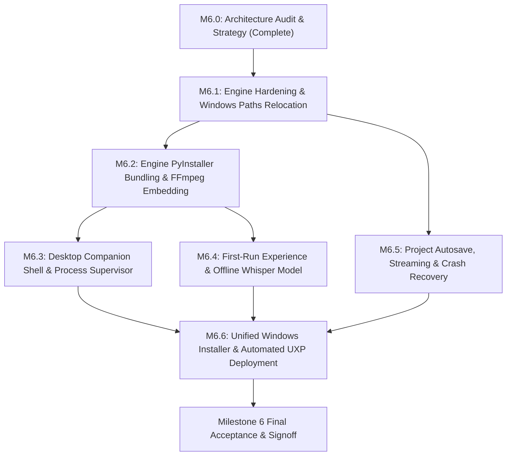

# CAPTIONLAB — MILESTONE 6.0
# PRODUCTION IMPLEMENTATION ROADMAP & PHASE SPECIFICATION

**Product:** CaptionLab — Words into Motion  
**Phase:** Milestone 6: Product Stabilization, Packaging & Windows Distribution  
**Scope:** M6.1 through M6.6  
**Target Platform:** Windows 10 / 11 x64  
**Primary Host:** Adobe Premiere Pro 2025+ (UXP) & 2023 (Standalone Companion)  

---

## 1. MILESTONE 6 PHASE DEPENDENCY OVERVIEW



---

## 2. SUB-PHASE SPECIFICATIONS

---

### M6.1 — Engine Hardening & Windows Configuration Relocation — `[COMPLETED]`

#### Status: COMPLETE (November 21, 2026)
- **All 4 Workstreams Implemented:** Windows storage relocation to `%LOCALAPPDATA%\CaptionLab`, dynamic `%WINDIR%\Fonts` resolution, session token constant-time verification & route protection, and `Local\CaptionLabEngineMutex` single-instance protection.
- **Automated Tests:** 86/86 tests passing ($100\%$).
- **Documentation:** See [MILESTONE_6_1_ENGINE_HARDENING.md](file:///c:/Users/HP/Documents/Caption_Lab/docs/MILESTONE_6_1_ENGINE_HARDENING.md).

#### Objective:
Eliminate hardcoded paths and in-repo storage. Move all mutable state (SQLite database, model caches, logs, renders) to standard Windows user directories (`%LOCALAPPDATA%` and `%TEMP%`). Enforce loopback security and single-instance port protection.

#### Scope of Work:
- `engine/app/core/config.py`: Update `Settings` to resolve `APP_DATA_DIR` via `%LOCALAPPDATA%\CaptionLab` and `APP_TEMP_DIR` via `%TEMP%\CaptionLab`.
- `engine/app/core/security.py`: Implement genuine session token verification. Enforce token validation on state-modifying routes.
- `engine/app/services/font_service.py`: Replace `C:/Windows/Fonts` with `%WINDIR%\Fonts`. Ensure font searches handle non-C drives.
- `engine/app/main.py`: Add single-instance Windows mutex or port-busy detection. If port 8765 is occupied, attempt graceful handshake or report structured diagnostic error.
- `standalone/src/components/StandaloneSettingsTab.tsx`: Replace hardcoded `http://127.0.0.1:8765` with `ENGINE_BASE_URL`.

#### Acceptance Criteria:
1. `config.py` creates data directories in `%LOCALAPPDATA%\CaptionLab` and temp directories in `%TEMP%\CaptionLab`.
2. No write operations occur in the engine code directory during execution.
3. Requests with invalid or missing session tokens receive `HTTP 401 Unauthorized` on protected routes.
4. All 73 existing automated tests continue to pass without regression.

#### Verification Commands:
```powershell
python -m unittest engine/tests/run_all_tests.py
python -c "from app.core.config import settings; assert 'AppData\\Local' in str(settings.DATA_DIR)"
```

---

### M6.2 — Python Engine Bundling & Toolchain Embedding

#### Objective:
Package the Python 3.11 FastAPI backend into a self-contained, standalone Windows executable (`captionlab-engine.exe`) using PyInstaller `--onedir`. Embed static `ffmpeg.exe` and `ffprobe.exe` binaries.

#### Scope of Work:
- Create `engine/captionlab_engine.spec`:
  - Include hidden imports for `ctranslate2`, `faster_whisper`, `torch`, `silero_vad`, `PIL._imagingraqm`, `aiosqlite`.
  - Bundle `NotoSansDevanagari-*.ttf` fonts inside the package assets.
  - Exclude heavy unused modules (`torch.distributed`, `torch.testing`, `matplotlib`).
- Create `bin/ffmpeg/`: Place static LGPL x64 builds of `ffmpeg.exe` and `ffprobe.exe`.
- `engine/app/main.py`: Add startup hook to prepend `bin/ffmpeg` to `os.environ["PATH"]`.
- Create build script `scripts/build_engine.py`.

#### Acceptance Criteria:
1. Running `scripts/build_engine.py` generates `dist_engine/captionlab-engine/captionlab-engine.exe`.
2. Executable starts up and responds to `GET /health/` within $< 2.0\text{ seconds}$.
3. CUDA and CPU int8 transcription work without requiring an external Python environment.
4. `shutil.which("ffmpeg")` resolves to the bundled binary with zero system PATH modifications.

#### Verification Commands:
```powershell
python scripts/build_engine.py
Start-Process dist_engine\captionlab-engine\captionlab-engine.exe
curl.exe http://127.0.0.1:8765/health/
```

---

### M6.3 — Desktop Companion Shell & Process Supervisor

#### Objective:
Wrap the Standalone Companion frontend (`standalone/dist/`) in a lightweight Windows native application shell using Tauri v2. Implement process supervision for the bundled Python engine.

#### Scope of Work:
- Initialize Tauri v2 configuration (`src-tauri/tauri.conf.json`, `src-tauri/Cargo.toml`).
- Configure `tauri.conf.json` with `externalBin: ["captionlab-engine"]`.
- Implement Rust sidecar manager (`src-tauri/src/main.rs`):
  - Generate secure session token on startup.
  - Spawn `captionlab-engine.exe` with port 8765 and session token as arguments.
  - Monitor engine health via periodic ping.
  - Gracefully terminate engine (`SIGINT`/`TerminateProcess`) when the main window closes.
- Configure WebView2 window: 1280x800 minimum, dark titlebar matching Premiere aesthetics.

#### Acceptance Criteria:
1. Launching `CaptionLab.exe` automatically starts `captionlab-engine.exe` in the background.
2. The Standalone Companion loads immediately inside the native window.
3. Closing the desktop window terminates both the frontend and the backend engine processes cleanly.
4. Total idle RAM consumption of the desktop shell is $< 60\text{ MB}$.

#### Verification Commands:
```powershell
cargo build --release --manifest-path src-tauri/Cargo.toml
Start-Process src-tauri\target\release\CaptionLab.exe
# Verify window opens and port 8765 is active
Get-NetTCPConnection -LocalPort 8765
```

---

### M6.4 — First-Run Experience & Offline Readiness

#### Objective:
Guarantee out-of-the-box offline transcription. Pre-bundle the factory-default Whisper model snapshot. Provide a hardware acceleration diagnostics wizard and an on-demand model manager.

#### Scope of Work:
- Pre-cache model snapshot `models--Systran--faster-whisper-small` (~465 MB) into `models_cache/` for inclusion in installer.
- `engine/app/services/transcription.py`:
  - Enhance `get_or_load_model` to verify local snapshot integrity before initiating download.
  - Implement a dedicated background download endpoint (`POST /transcribe/models/download`) with progress reporting.
- Frontend Onboarding Dialog:
  - Detect GPU / CPU compute capabilities on first launch.
  - Display green checks for FFmpeg, Devanagari fonts, and local model availability.
  - Provide test transcription button on bundled sample audio (`sample_speech.wav`).

#### Acceptance Criteria:
1. First-time transcription runs successfully with network adapters disabled (airplane mode).
2. The user is never blocked or prompted to enter developer commands.
3. System diagnostics page accurately reports GPU name, VRAM, and bundled model status.

#### Verification Commands:
```powershell
# Disable network and verify offline transcription
python engine/tests/run_all_tests.py
```

---

### M6.5 — Project Safety, Autosave & Export Streaming

#### Objective:
Prevent data loss, implement crash auto-recovery, enable real-time export progress streaming, and add export cancellation.

#### Scope of Work:
- `engine/app/services/db.py`:
  - Implement WAL mode (`PRAGMA journal_mode=WAL;`) for SQLite to prevent database locks.
  - Add `projects.is_auto_backup` flag and automatic rolling backup to `data/backups/`.
- `plugin/src/store/projectStore.ts`:
  - Auto-restore the most recently modified project on startup if unsaved changes were pending.
  - Display "Restored from crash" notification if previous session terminated abnormally.
- `engine/app/api/routes/render.py`:
  - Add Server-Sent Events (SSE) or WebSocket endpoint for real-time frame rendering progress (`GET /render/progress/{job_id}`).
  - Add cancellation endpoint (`POST /render/cancel/{job_id}`) that terminates the active frame render loop and cleans up scratch files immediately.

#### Acceptance Criteria:
1. Abrupt engine termination during editing does not corrupt `captionlab.db`.
2. On relaunch, the user is offered one-click recovery of their last project state.
3. Export dialog displays accurate percentage and frame count progress.
4. Clicking "Cancel Export" stops rendering within $< 500\text{ms}$ and purges temporary files.

#### Verification Commands:
```powershell
python -m unittest engine/tests/test_milestone5_design_and_presets.py
```

---

### M6.6 — Unified Windows Installer & Automated UXP Deployment

#### Objective:
Generate a single, production-signed Inno Setup installer (`CaptionLab_Setup_v1.2.0.exe`) that installs the Desktop App, Engine, Models, and automatically registers the Premiere Pro UXP Plugin.

#### Scope of Work:
- Create `installer/setup.iss` (Inno Setup 6 script):
  - Target: `{localappdata}\Programs\CaptionLab`.
  - Copy compiled UXP bundle directly to `{userappdata}\Adobe\UXP\Plugins\External\com.captionlab.premiere_1.2.0\`.
  - Copy offline Whisper model to `{localappdata}\CaptionLab\models_cache\`.
  - Create Start Menu and Desktop shortcuts.
  - Clean uninstaller that prompts: *"Would you like to preserve your CaptionLab projects and downloaded models?"*
- Create master packaging script `scripts/package_release.ps1` that orchestrates:
  1. `npm run build` in `plugin/`
  2. `npm run build` in `standalone/`
  3. `python scripts/build_engine.py`
  4. `cargo build --release` (Tauri Shell)
  5. `iscc installer/setup.iss`

#### Acceptance Criteria:
1. `CaptionLab_Setup_v1.2.0.exe` installs cleanly without admin privileges.
2. Premiere Pro 2025/2026 displays `CaptionLab Studio` under `Window > Extensions` immediately after installation.
3. Desktop shortcut launches CaptionLab Standalone Companion with background engine running.
4. Uninstaller cleanly removes binaries while respecting user project data.

#### Verification Commands:
```powershell
powershell -ExecutionPolicy Bypass -File scripts/package_release.ps1
```

---

## 3. IMPLEMENTATION SCHEDULE & PRIORITIES

| Sub-Phase | Priority | Status | Complexity | Key Milestone Deliverable |
| :--- | :---: | :---: | :---: | :--- |
| **M6.1** | **P0 (Critical)** | **COMPLETED** | Medium | Windows `%LOCALAPPDATA%` paths, security enforcement, mutex |
| **M6.2** | **P0 (Critical)** | **PENDING** | High | Standalone PyInstaller engine (`captionlab-engine.exe`) & FFmpeg |
| **M6.3** | **P1 (High)** | **PENDING** | Medium | Native Desktop Companion window (Tauri v2) & Sidecar manager |
| **M6.4** | **P1 (High)** | **PENDING** | Medium | Bundled offline Whisper model & first-launch onboarding wizard |
| **M6.5** | **P2 (Medium)** | **PENDING** | Medium | WAL mode SQLite, crash recovery, export progress & cancellation |
| **M6.6** | **P0 (Critical)** | **PENDING** | High | Inno Setup unified installer & automated UXP deployment |
| **M6.6** | **P0 (Critical)** | High | Inno Setup unified installer & automated UXP deployment |
