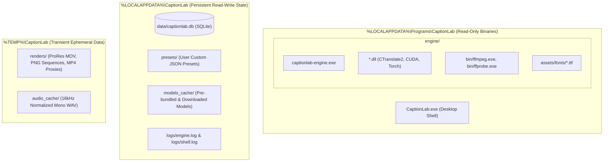

# CAPTIONLAB — MILESTONE 6.0
# WINDOWS DISTRIBUTION & PACKAGING STRATEGY

**Product:** CaptionLab — Words into Motion  
**Target OS:** Windows 10 / 11 x64 (Build 19041+)  
**Host Targets:** Adobe Premiere Pro 2025 / 2026+ (UXP) & Premiere Pro 2023 (Standalone Companion)  
**Distribution Target:** Single unified Windows installer (`CaptionLab_Setup_v1.2.0.exe`)  
**Document Status:** Architectural Specification  

---

## 1. DISTRIBUTION GOALS & PHILOSOPHY

CaptionLab is built on a **local-first, offline-capable, privacy-respecting foundation**. To preserve this in production:

1. **Zero Developer Prerequisites:** The end user must **not** be required to install Python, Node.js, Git, CUDA toolkits, or FFmpeg manually.
2. **Offline Day-One Operation:** The installer must include everything required to transcribe audio, design captions, animate typography, and export ProRes 4444 video immediately after installation without an active internet connection.
3. **No Administrator Lockout:** The application should default to a per-user installation in `%LOCALAPPDATA%\Programs\CaptionLab`, eliminating Windows User Account Control (UAC) permission errors and allowing installation on restricted enterprise or school workstations.
4. **Seamless Host Registration:** The installer must automatically register the UXP plugin with Adobe Premiere Pro 2025/2026 so it appears in `Window > Extensions` without requiring Adobe UDT.
5. **Clean Uninstallation & Data Respect:** Uninstallation must remove all application binaries and temporary files, while offering a clear prompt to preserve or delete the user's project database and custom presets.

---

## 2. DESKTOP APPLICATION SHELL EVALUATION

The standalone companion allows editors on Premiere Pro 2023 (or editors working independently of Premiere) to design and render captions. Currently, this runs as a browser tab on port 3000. For production, it must run inside a dedicated, native Windows application window.

### 2.1 Comparison Matrix

| Evaluation Dimension | Option A: Tauri v2 (Rust + WebView2) | Option B: Electron (Node + Chromium) | Option C: Custom C# Launcher (WPF / WinUI 3) | Option D: Python Qt (PySide6 / PyQt6) |
| :--- | :--- | :--- | :--- | :--- |
| **Shell Binary Size** | **~6 – 10 MB** | ~90 – 130 MB | ~15 – 25 MB | ~60 – 80 MB |
| **Idle RAM Footprint** | **~35 – 50 MB** | ~180 – 260 MB | ~60 – 80 MB | ~120 – 180 MB |
| **Windows 10/11 Integration** | **Native Evergreen WebView2** (pre-installed on 99%+ of Windows 10/11 systems) | Bundles separate Chromium engine | Native WebView2 / WinUI | Bundles separate Qt WebEngine |
| **Engine Process Management** | **Native Sidecar API** (spawns, health checks, restarts, terminates daemon) | Requires custom Node `child_process` supervisor | Requires custom .NET Process manager | Threaded inside Python or separate process |
| **Frontend Code Reuse** | **100% Reuse** (loads `standalone/dist/` directly) | 100% Reuse | 100% Reuse via WebView2 | Requires Qt bridge or embedded browser |
| **Security Architecture** | **High** (strict origin isolation, no Node remote code execution) | Low/Medium (Chromium node integration risks) | High | Medium |
| **Maintenance Burden** | **Low** (single `tauri.conf.json`, standard Vite pipeline) | High (Chromium security patches, large build pipeline) | Medium (requires .NET SDK & C# codebase) | High (PyInstaller multi-process conflicts) |

### 2.2 Selected Architecture: Tauri v2 Desktop Shell

**Decision: Adopt Tauri v2 as the Windows Desktop Shell for the Standalone Companion.**

#### Justification:
1. **Memory Efficiency:** CaptionLab's AI engine (Faster-Whisper + CTranslate2) requires 1.0 to 2.5 GB of RAM during transcription. Adding Electron's 250 MB idle memory overhead unnecessarily starves 8 GB and 16 GB editing laptops. Tauri's ~40 MB footprint is negligible.
2. **Process Supervision:** Tauri v2 provides first-class `sidecar` support. The Tauri binary (`CaptionLab.exe`) directly manages `captionlab-engine.exe` as a child process:
   - Spawns the engine on application launch with a randomly generated session token.
   - Polls `GET /health/` until ready.
   - Automatically restarts the engine if an unexpected crash occurs.
   - Guarantees termination of the engine process when the user closes the window, preventing orphaned background zombies.
3. **No Web View Version Fragility:** Windows 10 (Build 19041+) and all Windows 11 editions include Microsoft Edge WebView2 as an OS component updated by Windows Update.

---

## 3. PYTHON ENGINE BUNDLING STRATEGY

The Python engine (`engine/`) runs FastAPI, CTranslate2, PyTorch, Silero-VAD, Pillow, and aiosqlite.

### 3.1 Bundling Methodology: PyInstaller `--onedir`
We select **PyInstaller in `--onedir` mode** rather than `--onefile`.

- **Why Not `--onefile`?** A `--onefile` executable must extract several gigabytes of DLLs and Python libraries to a temporary folder (`%TEMP%/_MEIxxxxxx`) on **every single launch**, causing a 15–25 second launch delay and triggering antivirus heuristics.
- **Why `--onedir`?** All DLLs and Python runtimes reside permanently in `%LOCALAPPDATA%\Programs\CaptionLab\engine\`. Startup time is instantaneous (~1.2 seconds to reach the health endpoint).

### 3.2 PyInstaller Specification Design (`captionlab_engine.spec`)

```python
# -*- mode: python ; coding: utf-8 -*-
from PyInstaller.utils.hooks import collect_data_files, collect_submodules, collect_dynamic_libs
import os

block_cipher = None

# Collect Faster-Whisper, CTranslate2 and PyTorch runtime assets
ctranslate2_datas, ctranslate2_binaries, _ = collect_dynamic_libs('ctranslate2')
torch_datas, torch_binaries, _ = collect_dynamic_libs('torch')

hidden_imports = [
    'uvicorn.logging',
    'uvicorn.loops',
    'uvicorn.loops.auto',
    'uvicorn.protocols',
    'uvicorn.protocols.http',
    'uvicorn.protocols.http.auto',
    'uvicorn.protocols.websockets',
    'uvicorn.protocols.websockets.auto',
    'uvicorn.lifespans',
    'uvicorn.lifespans.on',
    'aiosqlite',
    'ctranslate2',
    'faster_whisper',
    'silero_vad',
    'soundfile',
    'PIL._imagingraqm',
    'regex',
]

datas = [
    ('engine/app', 'app'),
    ('engine/assets/fonts', 'assets/fonts'),
] + collect_data_files('faster_whisper') + collect_data_files('silero_vad')

# Strip unused heavy PyTorch subpackages to reduce disk footprint
excluded_modules = [
    'torch.distributed',
    'torch.testing',
    'torch.onnx',
    'scipy.spatial',
    'matplotlib',
    'tkinter',
    'test',
    'unittest',
]

a = Analysis(
    ['engine/run.py'],
    pathex=['engine'],
    binaries=ctranslate2_binaries + torch_binaries,
    datas=datas,
    hiddenimports=hidden_imports,
    hookspath=[],
    hooksconfig={},
    runtime_hooks=[],
    excludes=excluded_modules,
    win_no_prefer_redirects=False,
    win_private_assemblies=False,
    cipher=block_cipher,
    noarchive=False,
)

pyz = PYZ(a.pure, a.zipped_data, cipher=block_cipher)

exe = EXE(
    pyz,
    a.scripts,
    [],
    exclude_binaries=True,
    name='captionlab-engine',
    debug=False,
    bootloader_ignore_signals=False,
    strip=False,
    upx=False,  # UPX corrupts CTranslate2 / CUDA DLLs
    console=False,  # Headless background process
    icon='plugin/icons/icon_24.ico',
)

coll = COLLECT(
    exe,
    a.binaries,
    a.zipfiles,
    a.datas,
    strip=False,
    upx=False,
    name='captionlab-engine',
)
```

---

## 4. FFMPEG & THIRD-PARTY BINARIES BUNDLING

Currently, `export_service.py` calls `ffmpeg` from system PATH. In production:

1. **Pre-Built Static Binaries:**
   - Embed a static Windows x64 build of `ffmpeg.exe` and `ffprobe.exe` (LGPL release with FreeType, HarfBuzz, and ProRes encoder) inside `bin/ffmpeg/`.
2. **Dynamic PATH Injection:**
   - On engine startup in `engine/app/main.py`:
     ```python
     import os, sys
     from pathlib import Path

     def configure_embedded_binaries():
         if getattr(sys, 'frozen', False):
             base_dir = Path(sys._MEIPASS)
         else:
             base_dir = Path(__file__).resolve().parent.parent
         
         ffmpeg_dir = base_dir / "bin" / "ffmpeg"
         if ffmpeg_dir.exists():
             os.environ["PATH"] = str(ffmpeg_dir) + os.pathsep + os.environ.get("PATH", "")

     configure_embedded_binaries()
     ```
3. **Zero Configuration:** `shutil.which("ffmpeg")` immediately discovers the bundled binary. No system environment variables are modified.

---

## 5. WHISPER MODEL DISTRIBUTION & FIRST-RUN STRATEGY

| Model Size | Disk Footprint | Accuracy on Hindi/Hinglish | Memory (VRAM / RAM) | Distribution Strategy |
| :--- | :---: | :---: | :---: | :--- |
| **Tiny** | 75 MB | 65% (Draft) | ~1 GB | Download on demand |
| **Base** | 145 MB | 82% (Good) | ~1.2 GB | Optional download |
| **Small (Default)** | **465 MB** | **94% (High)** | **~2 GB** | **Pre-bundled in installer** |
| **Medium** | 1.5 GB | 97% (Very High) | ~4 GB | Download on demand |
| **Large-v3** | 3.0 GB | 99% (Maximum) | ~8 GB | Download on demand |

### Offline Day-One Execution:
- The installer bundles the **Small model snapshot** (`models--Systran--faster-whisper-small`).
- Extracted into `%LOCALAPPDATA%\CaptionLab\models_cache\`.
- Result: **The user can disconnect Wi-Fi entirely, install CaptionLab, launch Premiere Pro, and transcribe a Hindi video immediately.**

---

## 6. USER DATA, STORAGE & UAC DIRECTORY ARCHITECTURE

To comply with Windows architecture guidelines and eliminate UAC permission denials:



### Path Resolution in `engine/app/core/config.py`:
```python
import os
from pathlib import Path

local_app_data = Path(os.environ.get("LOCALAPPDATA", Path.home() / "AppData" / "Local"))
temp_root = Path(os.environ.get("TEMP", Path.home() / "AppData" / "Local" / "Temp"))

APP_DATA_DIR = local_app_data / "CaptionLab"
APP_TEMP_DIR = temp_root / "CaptionLab"

class Settings:
    DATA_DIR: Path = APP_DATA_DIR / "data"
    MODELS_DIR: Path = APP_DATA_DIR / "models_cache"
    LOGS_DIR: Path = APP_DATA_DIR / "logs"
    DB_PATH: Path = DATA_DIR / "captionlab.db"
    
    AUDIO_CACHE_DIR: Path = APP_TEMP_DIR / "audio_cache"
    RENDERS_DIR: Path = APP_TEMP_DIR / "renders"
```

---

## 7. ADOBE PREMIERE UXP PLUGIN AUTOMATED DEPLOYMENT

Adobe Premiere Pro automatically loads external third-party UXP plugins from a well-defined Windows directory:

$$\text{Path: } \texttt{\%APPDATA\%\textbackslash Adobe\textbackslash UXP\textbackslash Plugins\textbackslash External\textbackslash com.captionlab.premiere\_1.2.0\textbackslash}$$

### Automated Installer Actions:
1. Verify presence of Adobe Premiere Pro 2025/2026.
2. Deploy the compiled web bundle to the external directory:
   - `dist/index.html`
   - `dist/assets/main.js`
   - `dist/assets/main.css`
   - `manifest.json`
   - `icons/icon_24.png`, `icons/icon_24@1x.png`, `icons/icon_24@2x.png`
3. Result: **Zero configuration required by the editor. The panel is instantly available under Premiere's `Window > Extensions > CaptionLab Studio`.**

---

## 8. INNO SETUP UNIFIED INSTALLER SPECIFICATION (`setup.iss`)

```pascal
[Setup]
AppId={{5E7A8A3B-8F92-4C12-9A8E-2B6C3D4E5F6A}
AppName=CaptionLab
AppVersion=1.2.0
AppPublisher=CaptionLab Team
DefaultDirName={localappdata}\Programs\CaptionLab
DefaultGroupName=CaptionLab
PrivilegesRequired=lowest
OutputDir=dist_installer
OutputBaseFilename=CaptionLab_Setup_v1.2.0
Compression=lzma2/ultra64
SolidCompression=yes
SetupIconFile=plugin\icons\icon_24.ico
UninstallDisplayIcon={app}\CaptionLab.exe

[Tasks]
Name: "desktopicon"; Description: "{cm:CreateDesktopIcon}"; GroupDescription: "{cm:AdditionalIcons}"
Name: "uxpplugin"; Description: "Install Adobe Premiere Pro 2025/2026 UXP Plugin"; GroupDescription: "Host Integrations"

[Files]
; Standalone Desktop Shell & Engine
Source: "src-tauri\target\release\CaptionLab.exe"; DestDir: "{app}"; Flags: ignoreversion
Source: "dist_engine\*"; DestDir: "{app}\engine"; Flags: ignoreversion recursesubdirs

; Pre-bundled Offline Whisper Small Model
Source: "models_cache\models--Systran--faster-whisper-small\*"; DestDir: "{localappdata}\CaptionLab\models_cache\models--Systran--faster-whisper-small"; Flags: ignoreversion recursesubdirs

; Adobe Premiere Pro UXP Plugin
Source: "plugin\dist\*"; DestDir: "{userappdata}\Adobe\UXP\Plugins\External\com.captionlab.premiere_1.2.0\dist"; Tasks: uxpplugin; Flags: ignoreversion recursesubdirs
Source: "plugin\manifest.json"; DestDir: "{userappdata}\Adobe\UXP\Plugins\External\com.captionlab.premiere_1.2.0"; Tasks: uxpplugin; Flags: ignoreversion
Source: "plugin\icons\*"; DestDir: "{userappdata}\Adobe\UXP\Plugins\External\com.captionlab.premiere_1.2.0\icons"; Tasks: uxpplugin; Flags: ignoreversion recursesubdirs

[Icons]
Name: "{group}\CaptionLab"; Filename: "{app}\CaptionLab.exe"
Name: "{group}\Uninstall CaptionLab"; Filename: "{uninstallexe}"
Name: "{autodesktop}\CaptionLab"; Filename: "{app}\CaptionLab.exe"; Tasks: desktopicon

[Run]
Filename: "{app}\CaptionLab.exe"; Description: "{cm:LaunchProgram,CaptionLab}"; Flags: nowait postinstall skipifsilent

[UninstallDelete]
Type: filesandordirs; Name: "{localappdata}\CaptionLab\logs"
Type: filesandordirs; Name: "{temp}\CaptionLab"
Type: filesandordirs; Name: "{userappdata}\Adobe\UXP\Plugins\External\com.captionlab.premiere_1.2.0"
```
